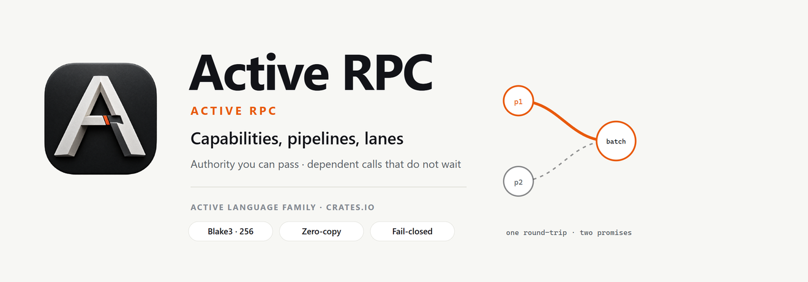
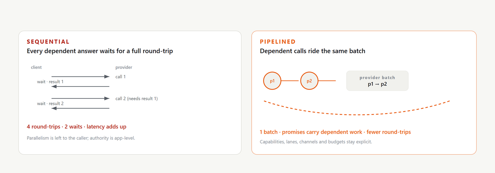
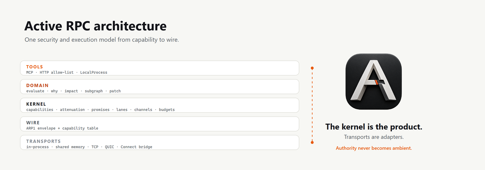
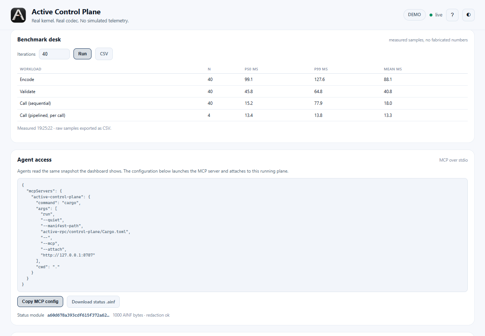

# Active RPC

<picture>
  <source media="(prefers-color-scheme: dark)" srcset="docs/assets/readme-banner-rpc-dark.png">
  <source media="(prefers-color-scheme: light)" srcset="docs/assets/readme-banner-rpc-light.png">
  
</picture>

**Capability-based · Promise-pipelined · Multi-lane · Multi-channel · Tool-aware · Infinity-native**

[](https://crates.io/crates/active-rpc)
[](https://docs.rs/active-rpc)
[](LICENSE-MIT)

Published crate family: `active-rpc`, `active-rpc-kernel`, `active-rpc-core`,
`active-rpc-client`, `active-rpc-tools`, `active-rpc-transport` and
`active-rpc-cli`. See
[`REGISTRY.md`](REGISTRY.md) for the module map.

Thank you for being here. Active RPC is the execution and security model for moving **Active Infinity** modules and authority between services and agents—without ambient permission, without “wait for every hop,” and without treating tools as an afterthought.

If Active RPC lets your agents collaborate directly, pipeline their reasoning, and hold only the authority they need, star the repo so the next team finds a stronger default.

---

## Install and use the CLI

```text
cargo install active-rpc-cli              # from crates.io
cargo install --path cli/active-rpc-cli   # from this checkout
```

```text
active-rpc-cli doctor
active-rpc-cli peer --limit 4 > peer.txt
ADDR=$(awk -F= '/^addr=/{print $2}' peer.txt)
CAP=$(awk -F= '/^cap=/{print $2}' peer.txt)
active-rpc-cli call --addr "$ADDR" --cap "$CAP" --method echo --text hello
active-rpc-cli pipeline --addr "$ADDR" --cap "$CAP" --calls 16
active-rpc-cli loadgen --addr "$ADDR" --cap "$CAP" --requests 200 --concurrency 8
active-rpc-cli events --plane http://127.0.0.1:8787 --follow
```

Exit codes are stable: `0` success, `1` refusal or failed request (for example
`rpc/method-not-granted`), `2` usage, `3` transport or codec failure. The manual
page is [`docs/man/active-rpc-cli.1`](docs/man/active-rpc-cli.1); the full
reference is [`cli/active-rpc-cli/README.md`](cli/active-rpc-cli/README.md).

---

## The thirty-second version

Most RPC stacks are excellent pipes. They move bytes and methods. They do not, by themselves, answer:

- Who is allowed to do *this* call?  
- Can I start the next question before the last answer arrives?  
- Can two agents talk without a shared message board?  
- Can a tool be granted narrowly and revoked cleanly?  
- Can evaluate / why / impact run under a budget on a real module?

Active RPC answers those with **capabilities**, **promises**, **lanes**, **channels**, and **domain operations** on Infinity payloads. Transports (in-process, shared memory, TCP, QUIC, interop bridges) are adapters. The kernel is the product.

<picture>
  <source media="(prefers-color-scheme: dark)" srcset="docs/assets/readme-compare-rpc-dark.png">
  <source media="(prefers-color-scheme: light)" srcset="docs/assets/readme-compare-rpc-light.png">
  
</picture>

**Active RPC is RPC with a security model and an agent model—not only a wire.**

---

## What you get when you adopt it

### Authority you can reason about

- **Capabilities** — unforgeable references; holding them *is* permission.  
- **Attenuation only narrows** — methods, budgets, paths, tool policy shrink, never silently grow.  
- **Revocation at dispatch** — revoked work does not reach the provider.  
- **Drop notification** — lifetimes are visible to the system.

### Speed of thought for multi-step work

- **Promise pipelining** — pass a pending result into the next call; dependent work proceeds without serial round-trip tax.  
- Measured design goal: pipelined chains cost fewer provider round-trips than equivalent sequential calls.

### Concurrency that matches real agents

- **Lanes** — independent execution contexts with budgets.  
- **Channels** — named streams for conversation and capability transfer, with
  per-capability topic sets that attenuation can narrow.  
- **Tools as capabilities** — MCP, HTTP allow-lists, sandboxed local processes—invoked under the same rules as everything else.

### Domain power on real modules

- `evaluate`, `why`, `impact`, `subgraph`, `patch` over Active Infinity—under capability and budget.  
- Secrets stay redacted on results that leave the boundary.

### Outcomes in the real world

| Scene | What changes with Active RPC |
|-------|------------------------------|
| Multi-agent coding / ops | Workers share channels and narrow capabilities; less “bus and hope.” |
| Tool-rich agents | MCP/HTTP/process handles are attenuated and budgeted. |
| Low-latency reasoning chains | Pipelining collapses wait time on dependent questions. |
| Config & policy services | Domain ops on Infinity modules with hash identity. |
| Mixed estates | Connect/gRPC-style bridges for peers not yet native; core stays capability-true. |
| Production visibility | Metrics and events for calls, refusals, budget pressure—without leaking secrets. |

---

## Quick start

```rust
use active_rpc::cap::CapAttrs;
use active_rpc::domain::ModuleProvider;
use active_rpc::value::{Arg, Value};
use active_rpc::{Agent, Budget};

let mut provider = ModuleProvider::new();
let module = active_rpc::domain::module_from_source(
    "[server]\nport = 8080\n",
    "demo.active",
)?;
let object = provider.install(module);
let agent = Agent::new();
let provider_id = agent.register(Box::new(provider));
let cap = agent.mint(provider_id, object, CapAttrs::new(&["evaluate", "why"]))?;
let lane = agent.create_lane("main", Budget::default())?;

let promise = agent.call(
    lane,
    &cap,
    "evaluate",
    vec![Arg::Value(Value::Path("server".into()))],
)?;
let _value = promise.value()?;
```

Pipelining sketch:

```rust
let first = agent.call(lane, &cap, "stats", vec![])?;
let second = agent.call(lane, &cap, "stats", vec![Arg::Promise(first.id())])?;
let _ = second.value()?;
// Provider round-trips collapse when the kernel batches dependent work
```

---

## Architecture at a glance

| Piece | Role |
|-------|------|
| Kernel | Capability table, promises, lanes/channels, dispatch |
| Identity | Mutual-TLS peer identity; a capability introduced to one peer is refused for another |
| Cap / attenuate | Authority and narrowing |
| Domain | Infinity-backed evaluate / why / impact / subgraph / patch |
| Tools | MCP, HTTP, LocalProcess adapters; `wasm-tools` runs fuel-metered WASM guests with no host imports |
| Wire (ARP1) | Envelope + capability table |
| Transports | In-process, shm, TCP, QUIC (mutual TLS), HTTP/2 (`http2`), interop bridge |
| Bulk | `ARBL`/`ARBC` chunked transfer with per-chunk hashes and resume |
| Observability | `active-rpc/observability/1` events and `active-rpc/metrics/1` counters, correlation ids only |

<picture>
  <source media="(prefers-color-scheme: dark)" srcset="docs/assets/readme-arch-rpc-dark.png">
  <source media="(prefers-color-scheme: light)" srcset="docs/assets/readme-arch-rpc-light.png">
  
</picture>

---

## How it compares (benefit-led)

| Concern | Typical request/response RPC | Active RPC |
|---------|------------------------------|------------|
| Authority model | App-level checks | Capabilities + attenuation |
| Dependent calls | Wait each hop | Promise pipelining |
| Agent concurrency | Roll your own | Lanes + channels |
| Tools | Side channel | First-class capabilities |
| Module semantics | Opaque bytes | Infinity domain ops |
| Secrets on results | App discipline | Redaction on domain results |

Interop bridges exist so adoption can be incremental. The native path is capability-native.

---

## Hardened for production

Active RPC carries multi-round review history, budget and revocation fixes, finite registries, tool policy enforcement, safe metrics/events, and a dependency floor on hardened Active Infinity. See `SECURITY.md`, `REVIEWS.md`, and hardening docs in-tree.

**No ambient authority**: the kernel does not open sockets or read the
environment on its own. Holding a capability is permission; attenuation narrows
it; revocation stops it at dispatch.

## Live Control Plane

This repository ships **Active Control Plane**, a local service that embeds the
real `Agent` and the real Infinity codec. It serves a live dashboard with
event-driven Live activity, 20 source-labelled gauges and an L0–L6 scenario
ladder, plus REST and WebSocket snapshots and an MCP server for agents.

<picture>
  <source media="(prefers-color-scheme: dark)" srcset="docs/assets/control-plane-dark.png">
  <source media="(prefers-color-scheme: light)" srcset="docs/assets/control-plane-light.png">
  
</picture>

<picture>
  <source media="(prefers-color-scheme: dark)" srcset="docs/assets/control-plane-gauges-dark.png">
  <source media="(prefers-color-scheme: light)" srcset="docs/assets/control-plane-gauges-light.png">
  
</picture>

<picture>
  <source media="(prefers-color-scheme: dark)" srcset="docs/assets/control-plane-benchmark-dark.png">
  <source media="(prefers-color-scheme: light)" srcset="docs/assets/control-plane-benchmark-light.png">
  
</picture>

<picture>
  <source media="(prefers-color-scheme: dark)" srcset="docs/assets/control-plane-mcp-dark.png">
  <source media="(prefers-color-scheme: light)" srcset="docs/assets/control-plane-mcp-light.png">
  
</picture>

```bash
cd control-plane
cargo run
# dashboard:  http://127.0.0.1:8787
# REST:       /metrics /activity /engines /logs/tail?n=200
# WebSocket:  /ws
# MCP stdio:  cargo run -- --mcp
```

Every gauge names its source counter in the UI. The ladder runs real
pipelining, redaction, attenuation, revoke-before-dispatch, streaming, MCP and
HTTP tools, local process policy, channel sharing, pipeline stress, byte and
call budgets, tool payload ceilings, codec and RPC benchmarks, CSV export and a
fuzz smoke. Idle rates stay at zero until a real delta arrives. The ladder
executes the shipped public APIs; benchmark numbers are measured samples
exported as CSV, and the event log exports JSONL with a cursor for agents.

---

## Perfect partners

- **Active Infinity** — the payload and identity layer.  
- **Active** text language — human/agent authoring.  
- Your agents’ harness — mint narrow capabilities; let workers talk on channels.

---

## Continuing work after compaction

The maturity work is driven by `CHECKLIST.md` and `PROPOSAL.md`. When a long
session is compacted, recover the working thread before editing:

- `python scripts/recall.py --turns 20` prints the recent turns of the newest
  Grok session for this workspace: user instructions, assistant notes and the
  tools that ran. `--list` shows sessions, `--session <id>` selects one.
- Durable release state lives in the workspace memory topic
  (`~/.grok/memory-v2/workspaces/*/topics/active-infinity-rpc-release.md`).
- The current phase and its acceptance criteria are in `CHECKLIST.md`, with the
  reasoning in `PROPOSAL.md`.

The script reads local session files only; it sends nothing anywhere.

## License

MIT OR Apache-2.0

---

**Active RPC — authority you can pass, pipelines you can feel, modules you can trust.**


