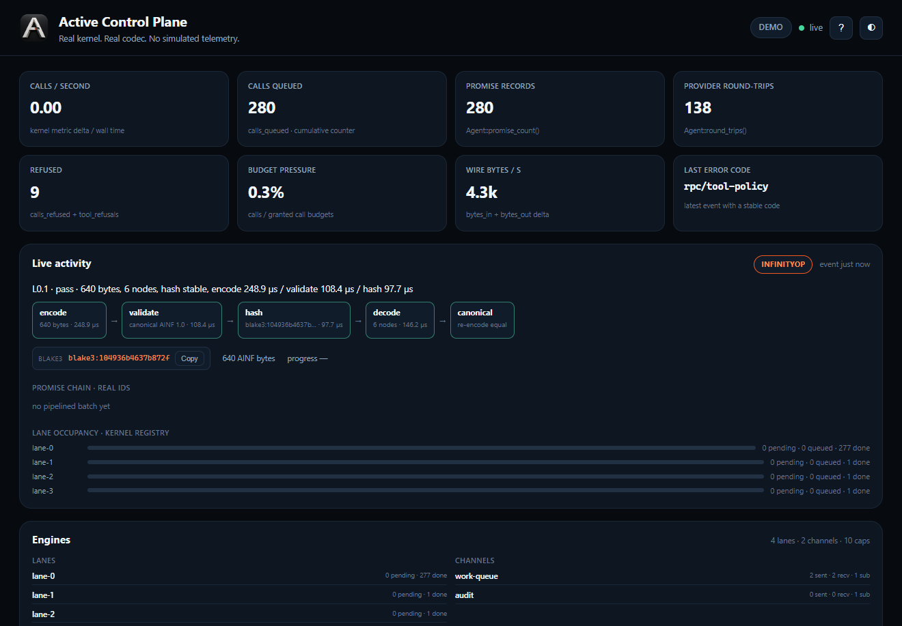

# Active Control Plane

A real, local instrument panel for `active-rpc` 2.0 and `active-infinity` 2.1.
It embeds a live `Agent`, runs a fixed ladder of scenarios through the shipped
capability, promise, budget, tool and streaming paths, and shows the measured
counters, events and codec timings in a dashboard.

No mock random walks. No invented throughput. Every gauge names its exact
source in the UI, and idle rates stay at zero until a real delta arrives.

<picture>
  <source media="(prefers-color-scheme: dark)" srcset="../docs/assets/control-plane-dark.png">
  <source media="(prefers-color-scheme: light)" srcset="../docs/assets/control-plane-light.png">
  
</picture>

## Run

```bash
cargo run
# dashboard  http://127.0.0.1:8787
```

```bash
cargo run -- --port 9000
cargo run -- --read-only                       # hide scenario and benchmark writes
cargo run -- --mcp --attach http://127.0.0.1:8787
```

The service binds `127.0.0.1` by default. Scenario IDs are a fixed allow-list.
`--read-only` (or `ACP_READ_ONLY=1`) keeps metrics, events, engines and logs
live while refusing scenario and benchmark writes.

## Live activity

The old static org chart is gone. The **Live activity** panel is event-driven
from the same snapshot stream as the timeline and log. Its state machine is
`Idle | InfinityOp | RpcBatch | ToolOp | StreamOp | Benchmark | Stress`, and it
only changes on real events.

It shows the current mode, a plain summary, the ordered stages with measured
durations, the Blake3 prefix and byte size for codec work, benchmark progress,
the promise ids from the last pipelined batch, and per-lane pending/queued/done
counts from the kernel registry. Clicking a gauge opens its definition, exact
source caption and the last ten samples.

The 20 gauges cover encode/decode/hash/validate µs, calls/s, wire bytes/s in and
out, settled/s, promise records, active lanes and channels, held capabilities,
tool calls and refusals/s, budget pressure, stream frames/s, canonical OK rate,
p99 call µs, cumulative calls queued, and pipeline depth.

## Scenario ladder

Every step runs the public APIs in this process and appends a structured
`scenario` event with its stable code and measured duration.

| Level | Steps |
|---|---|
| L0 Smoke | round-trip, module evaluate, metrics snapshot |
| L1 Core | pipelining vs sequential, redaction, attenuation refusal, revoke before dispatch, streaming reassembly |
| L2 Tools | MCP memory tool, MCP unknown tool refused, HTTP allow-list plus path escape, local process policy |
| L3 Concurrency | four-lane batch, channel capability share, 32-link pipeline stress |
| L4 Budgets | byte budget bomb, call budget storm, tool payload ceiling |
| L5 Benchmark | codec size benchmark, RPC call benchmark, benchmark CSV export |
| L6 Intense | fuzz smoke: corrupt images fail closed without a panic |

Run one step, a whole level, or every level up to a cut from the dashboard, the
REST API, or MCP.

## Surfaces

| Surface | Path | Content |
|---|---|---|
| Dashboard | `/` | live activity, gauges, timeline, log, ladder, benchmark, MCP panel |
| WebSocket | `/ws` | full `Snapshot` JSON on connect and on every real tick |
| Snapshot | `/metrics` | kernel, codec, engines, events, activity, gauges |
| Engines | `/engines` | real lane, channel and capability registries |
| Activity | `/activity` | current mode, stages, promise chain, lanes |
| Scenarios | `/scenarios` `/scenarios/results` | allow-list and latest pass/fail |
| Events | `/events` | structured redacted events |
| Logs | `/logs/tail?n=200` `/logs/since?id=…` `/logs/export.jsonl` | tail, cursor polling, JSONL |
| Scenario | `POST /demo/scenario/{id}` | runs real code, returns result + metrics |
| Level | `POST /demo/level/{level}?up_to=false` | one level or every level up to it |
| Benchmark | `POST /benchmark/run` `GET /benchmark/export.csv` | measured samples |
| Status module | `/status-module` | real AINF bytes (base64), hash and redacted JSON |
| MCP | `cargo run -- --mcp` | `cp_metrics`, `cp_activity_state`, `cp_events_tail`, `cp_events_since`, `cp_scenario_results`, `cp_engines`, `cp_run_scenario`, `cp_run_level`, `cp_status_module` |

`/engines` replaces the old `/topology` org chart. It reports only real
registries: lanes, channels and capability grants with correlation ids.

## Event log

Each event carries `id`, `ts_ms`, `category`, `kind`, `lane`, `capability`,
`method`, `code`, `duration_us`, `bytes`, `scenario_id` and a plain `detail`.
Filter chips cover CALLS, BATCH, REFUSALS, CAPS, SCENARIO, BENCHMARK, TOOL,
STREAM and SYSTEM. The log exports JSONL and supports cursor polling for agents.

The ring keeps 500 events and protects `scenario`, `benchmark` and `refusals`
records from ordinary progress chatter, so a security-relevant refusal is not
silently aged out.

## Truth rules

- Kernel counters come from `Agent::metrics()` and structured events.
- Infinity timings are `Instant` measurements around the shipped codec calls
  on the status module; the caption says exactly that.
- Benchmark p50/p99 are computed from raw microsecond samples, exported as CSV.
- Capability ids in the API and UI are correlation tokens. Raw authority bits
  never leave the kernel. A seeded canary is used only inside the redaction
  scenario and never appears in a payload, log or screenshot.
- Canonical OK rate counts real re-encode equality attempts; zero samples shows
  `0.0%` rather than a fabricated perfect score.
- Lane counts, channel message counts and promise records are registry reads,
  not estimates.

## Test

```bash
cargo test
cargo clippy --all-targets -- -D warnings
```

`tests/plane_tests.rs` drives `PlaneCore` against real engines: counter deltas,
pipeline round-trips, attenuation refusal, budget exhaustion, tool policy,
streaming stability, lane batching, channel sharing, revoke-before-dispatch,
redaction, benchmark samples, a valid status module whose hash matches its
bytes, the whole L0–L6 ladder, idle-zero rates and structured event cursors.
`tests/api_tests.rs` exercises the HTTP surface, JSONL export and read-only mode.
